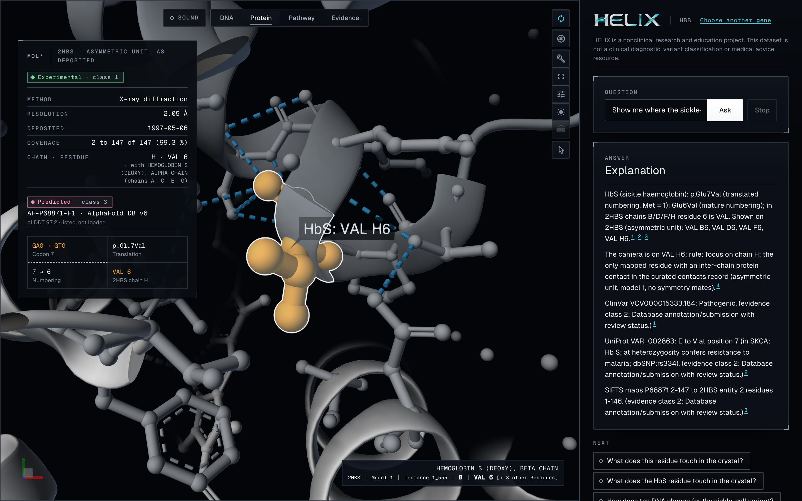
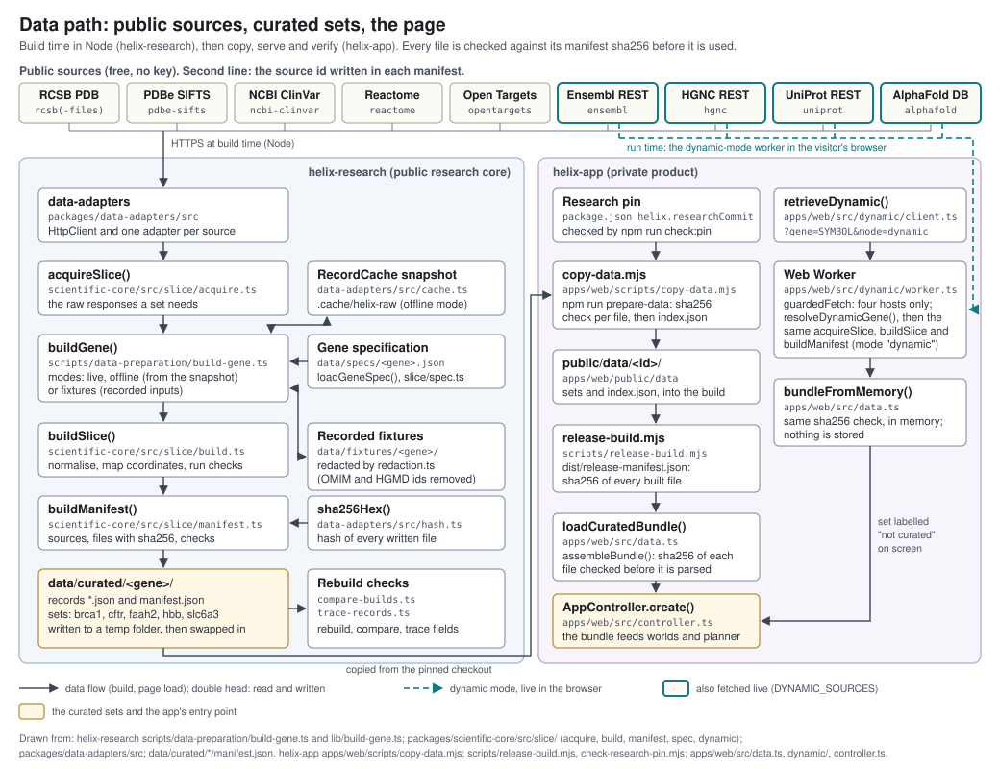
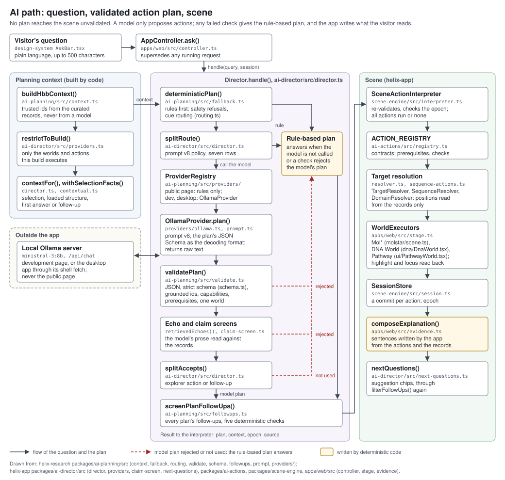
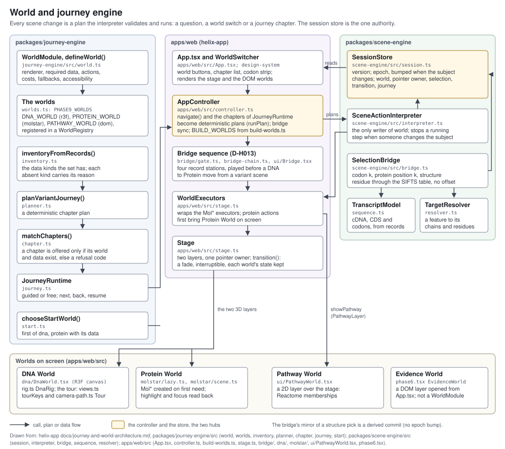
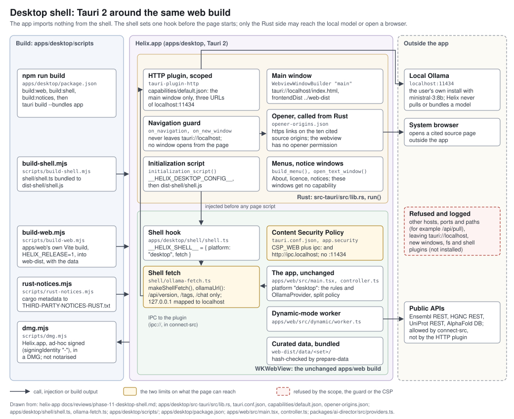

<!-- Copyright (c) 2026 Mohamed Bechir Kefi. All rights reserved. -->
# Helix: engineering case study

Helix is an interactive 3D genetics application. Real public records for a gene, its transcript, its protein, a variant and an experimental structure drive what is drawn. A visitor can ask a question in plain language, and the answer is a typed action plan that deterministic code validates against those records before anything in the scene changes. A language model, where one is present, only proposes the plan.

This case study is for a technical reviewer who wants to check the engineering and the sources. The first slice is HBB and the sickle-cell allele HbS. Everything here is written from the project's journal, reviews and claim register.

**How to read the citations.**
- `[C197]` is a row of the claim register, helix-research `paper/claims.md`, where each claim has its evidence and its limit.
- `HX-...` is a journal entry in helix-research `journal/`.
- A path such as `docs/reviews/phase-12-bor.md` is in this repository (helix-app, private); a path prefixed "helix-research" is in the public research repository.
- Unless stated otherwise, current numbers are from the Phase 12 build of record, helix-app e37efee with research pin 829a207, run from 2026-11-14 23:57 to 2026-11-15 07:28 (`docs/reviews/phase-12-bor.md`; HX-P12-2026-11-15-bor). Older numbers name their phase or build.

Helix is nonclinical. It is not a diagnostic, variant-classification or medical advice tool, and the app says so on screen (`docs/known-limitations.md` section 1, line `nonclinical`).

## 1. What Helix is

A sentence such as "sickle-cell disease is caused by a single letter change in the beta-globin gene" lives at several scales at once, from a position on chromosome 11 to a valine on the surface of a crystallised haemoglobin tetramer. The public resources that hold each fact use different coordinate systems, and moving between them correctly is expert work (helix-research `paper/report.en.md` section 1.1).

What a visitor gets in the web build:

- **A welcome** that opens a curated gene or answers the reference question.
- **DNA World**, a React Three Fiber scene of the gene's real transcript, drawn as an illustrative helix whose base i is base i of the curated cDNA.
- **Protein World**, the Mol* molecular viewer on the real experimental structure, with verified highlight and focus.
- **Pathway World**, Reactome memberships of the protein.
- **Evidence World**, a page layer with every record, its evidence class, review status and version.
- **A question box** answered by a rule-based planner on the public page, and by a local model on development pages and in the desktop app.

The build carries five curated genes: HBB, FAAH2, CFTR, BRCA1 and SLC6A3 (`docs/known-limitations.md` section 2.1). Any other recognised gene can be retrieved live in the visitor's browser without curation, from Ensembl, HGNC, UniProt and AlphaFold DB only, with no structure, variant, pathway or association view [C105].

There are two packagings of the same web code. The static web build is version 1.0.0, 94 files in its release form [C192]. A macOS desktop app made with Tauri wraps the same files and adds the user's own Ollama as a planner [C177, C179]. Hosting is prepared for Cloudflare (`docs/hosting-cloudflare.md`); nothing has been deployed, and publication is the author's decision after the Phase 12 gate.

Of the neighbours reviewed in Phase 1, none tied one validated action plan to genome, protein and structure coordinates with per-action provenance. This is an inference from the sources read, not a claim of being first [C28]. Authored molecular storytelling on 2HBS already exists (PDB-101, MolViewStories) [C29].

## 2. The demo: the critical question changing the world

The recording `docs/reviews/phase-12-demo/helix-phase12-demo.mp4` was made on 2026-11-15 from the release build of the build of record: MP4 H.264, 1920 x 1200, 30 fps, 93.0 s (`docs/reviews/phase-12-demo.md` section 1). The recorded build is helix-app 37c26f6, which differs from e37efee only in `docs/` and `e2e/` files and has the same 94 files and 17,315,539 bytes in its release manifest. It was served on a host name mapped to 127.0.0.1 so that the page runs as a public visitor sees it: platform web, rule-based planner only (HX-P12-2026-11-15-demo). Every shot is the real app. Captions, highlights, the title and end cards and two speed badges are drawn by a compositing canvas, never in the app's DOM [C198].

Timestamps below are from `docs/reviews/phase-12-demo/helix-phase12-demo.shots.md`.

| Time | What happens |
|---|---|
| 0:03.0 | HBB typed in the welcome; DNA World opens on the real Ensembl transcript |
| 0:11.1 | "Show me where the sickle-cell mutation affects hemoglobin." typed and answered by the rules |
| 0:19.5 | The camera reaches valine 6 of chain H in the 2HBS crystal; the residue is highlighted |
| 0:23.6 | Highlight on the codon change, GAG to GTG at codon 7, with the 7 to 6 numbering check |
| 0:27.4 | The evidence opens; every sentence cites its source record |
| 0:31.3 | The first follow-up the rules suggest, "What does this residue touch in the crystal?", answered by the rules with the residue's contacts in 2HBS |
| 0:44.5 | Back in DNA World, the mouse wheel zooms from codon to base pair |
| 0:51.9 | Evidence World: records with evidence class, review status and version |
| 0:59.4 | PTEN, not curated, retrieved live from four public services |
| 1:11.9 | Development page, labelled as such: "Show it as a surface." planned by ministral-3:8b through Ollama |

For the critical question the log records source `deterministic`, the executed actions `resolveVariant`, `loadStructure`, `focusCamera`, `highlightResidue` and `revealEvidence`, planning in 7.2 ms, and a change of world to Protein World (`docs/reviews/phase-12-demo.md` section 1, `logs/log-A.json` `q1`). The follow-up was also answered by the rules, with no model call [C198].

*Still `02-hbs-val6-2hbs.png` from the same run (2880 x 1800). Other stills: `01-hbb-dna-world.png`, `02b-follow-up-contacts.png`, `03-base-pairs.png`, `04-evidence-world.png`, `05-cftr-dna-world.png` (captured, left out of the cut), `06-live-gene-dna-world.png`, `07-local-model-surface.png`, all in `docs/reviews/phase-12-demo/stills/`.*

Two notes about the take:

- **Two waits are shown sped up**, each with a badge giving its real time. The live PTEN retrieval took 22.7 s (12 requests, all status 200) and the model's planning took 41.5 s from the click [C198].
- **The model segment is the development page on 127.0.0.1, not the desktop app.** No desktop segment was recorded (`docs/reviews/phase-12-demo.md` section 1). A public visitor never gets the model.

That the same question changes the world reliably was measured earlier in a controlled way. In Phase 4, the reference question led in 10 of 10 runs (5 rule-based, 5 ministral-3:8b) to Mol*'s own selection state reading back VAL 6 on chains B, D, F and H, with focus on H6 [C42].

## 3. Scientific research

Phase 1 wrote down, for each concept the app would show, what is known, the records to rely on, a valid visual form, the uncertainty, and the wrong interpretations to avoid (helix-research `docs/scientific-research.md`; URLs accessed 2026-11-01). For example: never draw the coding strand as the forward strand (HBB is on strand -1), and never present an AlphaFold model as "the structure".

The coordinate rules are in helix-research `docs/scientific-model-and-coordinate-mapping.md`: GRCh38 only for displayed coordinates, one internal convention (1-based closed, forward strand, explicit strand on features), the MANE Select transcript first, and residue mapping through SIFTS, never by adding an offset. The same document lists twelve observed pitfalls. Four of them shaped the code:

1. **E6V versus p.Glu7Val.** UniProt and HGVS number the glutamate 7; the legacy mature numbering calls it 6 because the initiator methionine is removed. Using 7 directly in 2HBS selects a GLU, the wrong residue.
2. **The structure file disagrees with UniProt.** The 2HBS file's own `_struct_ref_seq` numbering is off by one against current UniProt, so a parser that trusts it selects label 7 (GLU). SIFTS, RCSB and UniProt agree with each other [C08].
3. **rs334 is multi-allelic** (T/A/C/G). Only allele A is HbS, so Helix keys the variant to the allele and its HGVS g. description: NC_000011.10:g.5227002T>A, c.20A>T, p.Glu7Val [C05].
4. **The default view hides the contact.** In the 2HBS asymmetric unit only chain H Val6 makes an inter-chain contact within 4.5 A (chain B residues 70, 73, 84, 85, 88) [C10]. Assembly 1, which Mol*'s default preset loads, contains no such contact, so the default view would not show it [C11].

The reading that the H-to-B contact is the lateral fibre contact described by the structure's authors is labelled as an inference, not verified (helix-research `paper/report.en.md` section 4.5). Literature identifiers were checked through Europe PMC; only titles and metadata were read (helix-research `docs/scientific-research.md`).

## 4. HBB data mapping

**From genome to residue.** The HbS chain, each step confirmed by two or more records (helix-research `paper/report.en.md` table 4.2):

| Layer | Value |
|---|---|
| Gene | HBB, ENSG00000244734.6, GRCh38 chr11:5225464-5229395, reverse strand [C04] |
| Transcript | ENST00000335295.4 = NM_000518.5, MANE Select [C04] |
| Allele | g.5227002T>A, c.20A>T, p.Glu7Val [C05] |
| Protein | translated CDS = ENSP00000333994.3 = UniProt P68871, 147 aa, matching md5 [C06] |
| Structure | UniProt 7 = mature 6 = 2HBS label 6 = auth 6 (VAL), chains B, D, F, H [C07] |
| Clinical record | ClinVar VCV000015333, Pathogenic, criteria provided, multiple submitters, no conflicts; version .183 in Phase 2, .184 at the Phase 6 rebuild [C09, C59] |

**How the data are built.** Three runtime packages in helix-research separate schemas (`shared-types`), parsing of untrusted bodies (`data-adapters`) and deterministic logic (`scientific-core`). They use only web-platform APIs, enforced by typecheck settings and a source-scanning test [C27]. One build script produces a curated set from a short gene specification, with HBB as one instance [C94]. Each set holds its records, the full-chain SIFTS mapping, a predicted-model record marked unusable for variant placement, a capability index and a manifest with full provenance (helix-research `docs/data-core.md` section 8).

**Checks that fail closed.** The first HBB set passed 46 of 46 build checks from a live build [C24]; the extended set passed 53 of 53 [C60]. The full-chain SIFTS record maps P68871 2 to 147 onto 146 residues per beta chain, and in the app 146 of 146 mapped codons linked to exactly those residues [C61]. Proprietary identifiers (OMIM, HGMD) are removed from stored records, with the original response hashes kept [C03]. Every record of the HBB slice came from free, unauthenticated public endpoints [C01].

**What the visitor sees.** Every data source of the shipped sets (Ensembl, UniProt, RCSB PDB, SIFTS, AlphaFold DB, ClinVar, HGNC, Reactome, Open Targets) has its attribution string on screen in Evidence World [C158].

**Generalisation.** The other four curated sets exercise different cases:
- CFTR F508del, an in-frame deletion read from the responses [C97];
- BRCA1 C61G on 1JM7, an NMR domain structure covering 5.5 % of the protein [C101, C102];
- SLC6A3 R85W, added with no app source change [C104];
- FAAH2, a gene with no PDB structure, chosen by a seeded walk over HGNC identifiers [C95, C96].

**A provenance gap.** The HBB set rebuilds from its public recorded inputs to the same values, but 14 provenance hashes of five sources differ, because four cited responses must be published redacted and one Ensembl response was recorded nowhere [C167, C168]. The author accepted this as a limitation (D-H042). Every displayed record field still agrees with its raw upstream body: 159 of 159 [C144].

## 5. AI architecture and tool safety

**The flow.** The Director (`packages/ai-director`) resolves gene names over the trusted records, asks the active provider for a plan, runs `validatePlan`, and falls back to the rule-based plan on any failure. The plan carries the epoch and the context it was validated against. The Scene Action Interpreter then validates again and executes (section 6; `docs/ai-architecture-and-action-contracts.md` sections 2 and 3).

**Who may plan.** A public web page gets the rule-based planner only. Development pages and the desktop app add `ollama:ministral-3:8b` behind it (same document, section 3). Phase 1 measured why: an arbitrary web origin got HTTP 403 from Ollama's CORS check [C22].

**Why validation is the safety layer.** In the Phase 1 desktop experiment, llama3.1 returned a schema-valid plan for the wrong structure (1BZO instead of 2HBS) [C23]. The plan schema is strict. `validatePlan` rejects unknown fields, unknown actions, identifiers outside the trusted context (in structured fields and in free text, unless the user typed them), non-executable actions and unmet prerequisites [C30]. In the Phase 3 benchmark, validation caught every ungrounded identifier in every run [C35]. Its limit is stated in the register: validation cannot catch a plan that is valid but wrong.

**Model choice and its measured limits.**
- Phase 3 compared four local models on 53 items with oracles written before any model ran. On the main set ministral-3:8b was correct and valid on 86.8 % of outputs, ahead of qwen3.5:4b, llama3.1:8b and phi4-mini [C31, C33].
- On 16 held-out items the deterministic fallback (75.0 %) scored higher than every model [C34].
- An in-browser model was tried and dropped: a 1.08 GB download, 4 of 10 plans correct and valid [C38], and a 28.7 s scene freeze with the engine on the main thread [C39].

**The split Director (shipped).** On the held-out set frozen with prompt v8 (58 units, 3 repeats), the split policy was correct and valid on 120 of 174 outputs, against 96 for the rules alone, 135 for the model alone and 144 for a model-first Director. It was also the safest after review: 165 of 174, with injection held 18 of 18 [C115]. The split calls the model only where it measured better: the six explorer actions and follow-ups. Safety refusals, clarifications and any context carrying retrieved untrusted text stay with the rules (`docs/ai-director-split-policy.md` section 2).

**What the visitor reads.** The visitor never reads model prose. The app writes every sentence from the executed plan and the records, and the model's follow-up suggestions are not offered (D-H029, `docs/ai-director-split-policy.md` section 7) [C121]. A claim screen also reads the model's text and rejects the plan on a hit. Its held-out record is weak: 7 units fired, all false positives on reading, and it missed the one violation that reached it [C116]. The author keeps it as a safety net; validation, not the screen, is the layer the measurements support (D-H026).

**Waiting for a model.** Model planning takes seconds. The split medians are 12.9 s on an explorer rule and 25.1 s on a follow-up (`docs/known-limitations.md` section 2.3; HX-P11-2026-11-10-new-budgets). An "Answer with the rules now" control cancels the call. Pressed 1.5 s into a model call, the rules' answer completed 5.2 to 6.8 s after the press, most of it the bridge sequence and the transition [C121].

**Untrusted input more broadly.** The web build renders no question or retrieved text as HTML and executes no generated code [C147]. Questions are limited to 500 characters [C152]. A Content Security Policy with no inline script, no eval and no inline style held every main suite while enforced [C148]. A recorded session sent nothing about the visitor: no cookie, no identifier, and storage was empty afterwards [C149].

## 6. Scene and action interpreter

**Actions name semantic ids, never geometry.** Sixteen actions are executable. AI output never names meshes, URLs, chains, residue numbers or sequence positions; deterministic code resolves the semantic ids. Each action's contract (targets, prerequisites, scientific checks, capabilities, result, cancellation, fallback) is in a table generated from the registry source, and a test fails if they drift apart (`docs/ai-architecture-and-action-contracts.md` section 4).

**Validation is all-or-nothing, before anything executes** (section 6 of that document):

1. The plan's epoch must equal the session's epoch, or the request is rejected as stale.
2. `validatePlan` runs against the context the plan was made with.
3. `unsupported` and `clarify` answers complete without touching the scene.
4. For each action in order, over a projected state: the registry contract, executor capabilities, prerequisites, then the scientific checks.

**Read-back closes the loop.** After a highlight, the interpreter checks that Mol*'s selection manager holds exactly the resolved residues (`readback-equals-mapped`). On a mismatch, the emphasis is cleared and the request fails, so an unverified highlight never stays on screen. Similar read-backs exist for focus, the drawn transcript, domains, pathways, representation and the overview (the scientific checks table in section 4).

**One store.** The session store's epoch increases when the scientific subject changes. The renderers never write it directly: a click in Mol* becomes a `viewer` commit (section 5).

**Measured behaviour.**
- A plan made before the user changed the selection was rejected as stale, and a question superseded during inference was discarded [C47].
- Interrupting a transition by Stop, Escape or a pointer press returned to the starting world in a median 29 ms, with the selection kept [C53].
- Replayed through the real Director and interpreter, 109 of 112 frozen Phase 10 plans executed without error, with 0 read-back mismatches over 199 step checks. The 3 failures were `showPathway` on a membership whose participants the record does not keep [C112].

**The journey engine** (`docs/journey-and-world-architecture.md`).
- Worlds are declared modules. A world without an accessibility alternative, a fallback or its costs does not compile.
- A capability matcher offers a chapter only when its data exist. Over all 4,096 subsets of the 12 data kinds, it never offered a chapter missing a data kind it needs [C54].
- The selection bridge links codon k to protein position k, then to structure residues only through the SIFTS table of record. Codon 1 and the stop codon say why they have no residue [C51, C61].

## 7. 3D rendering techniques

**Coordinated canvases.** Phase 1 chose coordinated canvases over one shared WebGL context: Mol* owns every real structure, R3F owns the illustrative DNA layer, one store drives both, and the renderers never call each other (helix-research `docs/rendering-integration-decisions.md` section 4). Mol* has no supported API for drawing into a foreign three.js scene, and with vsync on both canvases together held 16.7 ms frames in every configuration [C17].

Two findings from that phase became rules:
- **One pointer owner.** Overlaid canvases need a single pointer owner, or one click produced two store updates [C18].
- **Load the asymmetric unit.** `loadStructure` carries the assembly explicitly, because the default would hide the HbS contact [C11].

**DNA World.** The helix is illustrative geometry over a real sequence, labelled "Illustrative geometry, real sequence" on screen. In the running app, its meshes carried the 628-base curated cDNA of ENST00000335295.4 base for base (0 of 628 colour mismatches), and 6 of 6 real clicks selected the clicked base [C50]. The canvas uses `frameloop="demand"`. With it, no Mol* spin long frame occurred in any condition; with an always-rendering visible R3F canvas, every spin start stalled about 1.9 to 2.4 s [C56].

**Art direction.** Three concepts were built as live prototypes on the real cDNA. Instrument was chosen. Uncapped, it had no frame over 50 ms, while Atrium stalled once per page and Deep Field showed periodic long frames [C81]. After refinement, its full-effects tour measured 8.1 ms median and 8.8 ms p95 with vsync off, with 0 idle frames at rest [C82]. Its scene rules (`docs/design-system.md` section 1):
- depth of field only during the camera tour;
- amber collars on the coding strand only at the variant codon;
- effects below screen resolution during the tour.

**The bridge.** Moving from a DNA World variant scene to Protein World plays a four-station sequence read from the records: codon 7 GAG to GTG; p.Glu7Val; 7 to 6 because the initiator methionine is removed; 2HBS chain H VAL 6. It has pause, step and skip controls. If any link fails its check, the sequence is refused and the scene lands directly in Protein World (helix-research `paper/report.en.md` section 9.4).

**Device tiers.** Four rendering tiers are chosen from browser capabilities and a frame probe at the welcome: full, balanced, low power, and a page without 3D. Each chose as expected under 13 emulated conditions on one Mac [C131]. A browser that names a software renderer reaches the page without 3D in about 1.2 to 1.3 s [C136].

**Desktop rendering.** In WKWebView both canvases match Chrome's read-backs to a mean absolute difference of 0.024 and 0.048 of 255 per channel [C178].

## 8. UX decisions

The author made these decisions; they are encoded as tokens and tests (`docs/design-system.md` section 1).

**Colour has fixed meanings.**
- Amber means the variant and nothing else. A test keeps every other semantic colour at least CIEDE2000 20 away from it.
- Errors have their own fault colour, 35.7 from amber [C83].
- Cyan means discovery and selection.
- Evidence classes carry a word and a class number as well as a hue, so colour is never the only channel.
- Since Phase 8, all 241 text and background pairs of the contrast register reach 4.5:1 or more [C92].

**Start and navigation.**
- The welcome opens on every visit, and nothing about it is stored. A data-checked rule chooses DNA World as the start world (`docs/journey-and-world-architecture.md` section 12).
- A "Choose another gene" link sits beside the gene symbol [C173].
- The 3D worlds need a viewport at least 1024 CSS px wide. A narrower window gets a page with the sequence, the evidence and the limitations [C122].

**Honesty in the interface.**
- The app shows its known limitations in the side panel, generated from each set's records (`docs/known-limitations.md` section 1).
- A rule-written answer is labelled "Planner message (rule-based)" (`docs/ai-director-split-policy.md` section 7).
- Rule-written suggestions no longer carry an "AI" mark [C173].

**Motion and sound.** Reduced motion cuts the tour and shows the bridge stations at once [C86]. Sound is opt-in: no AudioContext exists until the visitor presses "Sound", and cues stay at or under -24 dBFS peak [C89].

**Usability work without participants.** No usability test with real users was run. Instead, the AI inspected the release candidate with Nielsen's ten heuristics on 64 screen states and a cognitive walkthrough of eight tasks, and found 28 problems [C169]. The weakest task was changing gene: the rules gave a false refusal for another curated gene [C170]. Eight problems were fixed in Phase 11 [C172, C173] and nine of ten more in Phase 12, each pinned by a test that failed first. The Phase 12 fixes cost 671 bytes at rest [C196]. Because the inspector also built the app, these 28 findings are a lower bound (helix-research `paper/report.en.md` section 10).

## 9. Performance

Every budget is measured on one machine: an Apple M1 Pro with 16 GB on macOS 15.3.1, in headless Chrome over localhost (`docs/qa-and-performance.md` section 1). The budgets are regression guards for that reference, not statements about visitors' devices (`docs/known-limitations.md` section 2.4).

Measures on the build of record (`docs/reviews/phase-12-bor.md` section 5):

| Measure | Value | Budget |
|---|---|---|
| Web frame median, worst move (dpr 1 rerun / dpr 2 / low power) | 16.7 / 16.7 / 16.8 ms | 16.8 ms |
| Bytes at rest (vite preview) | 1,976,426 | 2,000,000 |
| Bytes at rest, static host, brotli / gzip | 1,787,776 / 1,971,131 | 2,000,000 |
| Welcome interactive, Fast 4G / Slow 4G | 2,452 / 9,069 ms | 3,000 / 10,000 ms |
| Cold switch to Protein World | 1,078 ms | 2,500 ms |
| Soak: Chrome tree at end; heap growth | 1,530 MB; 1 % | 1,800 MB; 5 % |
| Desktop cold / warm launch | 1,314 / 440 ms | 2,500 / 1,200 ms |
| Desktop memory after 6 round trips | 468.5 MB | 800 MB |
| DMG | 6,391,626 bytes | 10 MB |

Three readings of this table:

- **The frame budget has no margin.** The dpr 1 median was judged by its automatic rerun: 17 ms on the first run, 16.7 ms on the rerun, as the D-H038 rule provides (`docs/reviews/phase-12-bor.md` section 1). In Phase 11, one build read 17.0 ms on a loaded machine and 16.8 ms on a quiet one [C140].
- **Bytes at rest are a hard constraint.** Every product change since Phase 11 states its byte cost. As a meta element, the CSP would exceed the budget by 340 bytes, so it must be served as a header [C148]. Removing a duplicate copy of zod freed 24,597 bytes [C151].
- **Startup was a design task.** In Phase 8 the Mol* chunk and the structure file were deferred past the ready moment. Bytes before the first interaction fell from 1,918.6 kB to 677.7 kB [C87, C91].

**The desktop app.** Tauri 2.12.5 wraps the same web build; its web files are byte-identical to the web build's [C177]. On the network side:
- The HTTP capability allows exactly three Ollama URLs on localhost; other endpoints, ports, hosts, navigation and new windows were refused [C177].
- Links to cited sources open in the system browser only when they are https on one of ten origins derived from the records [C180].
- The CSP refused a remote script, an inline script, eval, a remote image, a remote frame and an unlisted fetch in the running app [C181].

Desktop frames use a desktop reading of the frame rule that the author agreed, because WebKit's clock has 1 ms resolution (D-H047) [C186]. On the build of record, four desktop frame passes under load each had one mid-move frame of 34 to 40 ms; the fifth pass had none and, as the automatic rerun, passed. No A/B against the gate's desktop build was made, so load and build are not separated (P12-BOR-02, `docs/reviews/phase-12-bor.md` section 3).

## 10. Tests

The gate suite is numbered S1 to S31. Every check is read by its exit code, never by eye. On the build of record, every judged check of the Phase 11 suite, plus the host check S30 and the release-contents check S31, exits 0 under the gate's pass rules [C197]. The table lists the main checks (`docs/reviews/phase-12-bor.md` section 1):

| Check | Result |
|---|---|
| S1, S2 app tests and typecheck | 674 passed in 62 files |
| S5 research tests and typecheck | 578 passed, 5 skipped (live) |
| S15, S16 replays of the frozen benchmarks | only the allowlisted units differ |
| S19 no model | 0 failures |
| S20 device tiers | 58 budgets ok, 0 over |
| S21 text inventory and axe | 9,126 texts from 80 screens; 0 axe violations |
| Source map | 9,126 of 9,126 texts mapped to a source |
| S29 layout | 245 screens, 0 failing, 0 axe violations |
| Security, CSP run and classification | 3 deliberate reports, 0 unexpected |
| S23 rebuilds and record trace | 199 manifest rows; 159 field checks agree |
| S24 live retrieval | PTEN retrieved in 7,383 ms, 12 requests |
| S25 audits (12) and cargo audit | exit 0 |
| S30 host check (local static host) | 15 pass, 0 fail, 3 n.a. |
| S31 release contents | 94 files listed with size and sha256 |

**What the suites cover.**
- **The frozen benchmarks** are scored again on every rules change. Rules versions 7 and 8 scored exactly as before on both sets [C194, C196].
- **The scientific audit** maps every displayed text on the rules' path to a record field or named code [C143], and compares 159 displayed fields with their raw upstream responses [C144]. S21 counted 9,126 texts on the build of record and 9,221 at the Phase 11 gate [C187]; the difference is in the counting, not in what the app shows: reference numbers became links in Phase 12, so sentences that differed only by the reference digits glued to their end now count once, and with those digits and run timestamps removed from both inventories the build of record has 8,958 distinct texts against 8,944 (docs/reviews/phase-12.md section 5).
- **Accessibility.** At the Phase 11 gate, axe ran in Chrome, Firefox and Safari with 0 violations in each [C138, C191].
- **The host check.** S30 tests every requirement of the security review against the served URL: the CSP as a header, the other headers, MIME types, caching and compression. A server sending no headers failed 11 requirements [C193].

**Harness faults are kept apart from app faults.** Four first failures on the build of record were faults in the tests. Three suites still expected behaviour that Phase 12 changed on purpose, and in the fourth my run script left out a port option. All four were corrected without touching an app file (`docs/reviews/phase-12-bor.md` section 2).

**Firefox and Safari are a record, not judged.** Firefox S9 and S13 and Safari S9, S12 and S13 exit 1, as at the gate, for automation reasons (no CDP session, a protocol timeout, no request interception under safaridriver). Firefox S7 exits 1 on the WebGL context count (P12-BOR-01, section 11). Safari S10 and S11 now pass. The cause of their earlier failures was Safari's automation, not the app [C195].

## 11. Limitations

These are stated plainly. The full list, each item with its consequence for a visitor, its evidence and its state, is `docs/known-limitations.md`.

**Review and evaluation.**
- **No user testing.** No usability session with participants was run and no questionnaire score exists. Usability was inspected by the AI only, which is not user testing (D-H031) [C169].
- **No independent domain expert.** The scientific claims were checked against their records by scripts and an AI-assisted audit. Agreement with an upstream body says nothing about whether the upstream database is right [C143, C144].
- **The audits were carried out with AI assistance.** This covers the scientific, security, accessibility, usability and licence audits. AI self-verification is not independent review. The security review included no penetration test (`docs/known-limitations.md` sections 2.9 and 2.12).
- **No screen-reader pass.** Accessibility was checked by script only; no one listened with a screen reader [C138].

**Hardware and browsers.**
- **One reference machine.** Every budget comes from one Apple M1 Pro. Slower devices were emulated by CPU throttling and software rendering, not tested on real hardware [C131].
- **Firefox and Safari as recorded, not judged.** Their runs are a record of function and accessibility. Performance was measured in Chrome and the desktop webview only (`docs/known-limitations.md` section 2.4).

**AI.**
- **The local model is only on the developer's machine or in the desktop app.** Public visitors never get Ollama. The public build uses the rule-based planner, which answers a limited set of questions: all 30 supported and bridge questions of the five sets [C130]. The desktop user must install Ollama and pull ministral-3:8b (about 6 GB) themselves; nothing is bundled or downloaded (`docs/known-limitations.md` section 2.13).
- **Model plans can be wrong.** On the held-out set, the split Director was correct and valid on 120 of 174 outputs [C115]. Validation catches ungrounded identifiers, not valid but wrong plans [C35].

**Distribution and hosting.**
- **The DMG is not notarised.** It is ad-hoc signed and arm64 only. Gatekeeper rejects a quarantined copy, and the build of record's checks exit 3, 3 and 70 as expected. It is not distributed (`docs/reviews/phase-12-bor.md` section 1). The launch from a fresh macOS account was not run (D-H047).
- **Nothing is hosted yet.** The host check ran on a local server applying Cloudflare's header rules. HTTPS, HSTS and Cloudflare's own compression are shown only by a rerun against a real URL [C193].

**Science and scope.**
- **Snapshot data.** Records drift between builds; ClinVar's HbS record moved from version 183 to 184 [C59].
- **The 2HBS crystal already carries Val** at the HbS site, so the reference Glu is compared on the sequence only. The contact is in the asymmetric unit, with no symmetry mates [C10].
- **The DNA helix is illustrative geometry**, and predicted models are listed, never used to place a variant (`docs/known-limitations.md` section 1).

**Open notes on the build of record** (`docs/known-limitations.md` sections 2.6, 2.8 and 2.13):
- **P12-BOR-01.** In Firefox, the 3D view's renderer setup sometimes runs twice and creates a second WebGL context: 7 of 10 loads on the build of record, 6 of 10 on the Phase 11 gate build, so it predates Phase 12. Whether the second context is released was not measured [C197].
- **P12-BOR-02.** In the desktop app on a busy Mac, a mid-move frame of up to about 40 ms; cause not established (section 9).
- **P12-U-01.** On the TP53 dynamic page, before any answer, a chapter shows the reference "?", because it cites an evidence id that is not among the side panel's cards.

## 12. Lessons

**Read the records before trusting a renderer's defaults.** Two Phase 1 findings would each have put the wrong thing on screen with no visible error: Mol*'s default assembly hides the contact the sickle-cell story is about [C11], and the structure file's own UniProt alignment selects a glutamate instead of the mutant valine [C08].

**A model's plan is a proposal, and the rules are a strong baseline.** A schema-valid plan for the wrong PDB entry [C23] set the design rule that deterministic code checks every identifier. The benchmarks then showed that a hand-written rule-based planner beat every local model on held-out items in Phase 3 [C34], and stayed competitive in Phase 10 [C115]. The shipped design gives the model only the parts where it measured better, and never shows its wording.

**Freeze the oracles and replay on every change.** Writing expected answers before any model ran, and scoring both frozen sets again on every rules version, made "this change touches nothing else" a checked statement [C31, C194, C196].

**Functional suites miss performance regressions.** At the Phase 11 gate, a usability fix passed every functional and accessibility check, but its forced synchronous render made drag and wheel moves 20 s later heavier under a slowed processor. Only the device-tier budget caught it, and a bisect named it. The mechanism is still not established [C189].

**Budgets without margin are fragile on one machine.** A 16.8 ms frame budget can fail on machine state alone, hence the rule of one automatic rerun and a recorded load average [C140, C155]. A tight bytes budget made every change a costed change and exposed a duplicated library [C151].

**Separate harness faults from app faults, in writing.** On the build of record, four first failures were harness faults; the two that were not are kept as open notes (`docs/reviews/phase-12-bor.md` sections 2 to 4).

**An inspector who built the app sees least of what a newcomer meets first.** The AI usability inspection found real problems, such as a false refusal that had passed the scientific audit because it had a named source [C170]. It cannot stand in for people using the app, and the case study does not claim that it does.

## How to verify

- **Claims.** Every bracketed id resolves to a row of helix-research `paper/claims.md` with its evidence files and its limit. Journal entries are in helix-research `journal/`, named by date and slug (for example `2026-11-15-p12-bor.md` for HX-P12-2026-11-15-bor).
- **The build of record.** `docs/reviews/phase-12-bor.md` lists every check with its exit code. The script and logs are in `docs/reviews/phase-12-bor/` (`run/run.sh`, `*/exits.txt`), and the result files in `apps/web/e2e/results/*p12bor*`.
- **The research pin.** From a clean clone with helix-research beside it, `npm run check:pin` fails if any consumed research path differs from the pin (`docs/ai-architecture-and-action-contracts.md` section 2).
- **Tests and builds.** Run `npm test` in each repository. Then `npm run web:build`, or `npm run release:build` for the release folder with its manifest of every file and sha256 (`docs/hosting-cloudflare.md`).
- **The served build.** From `apps/web`, run `node e2e/static-host.mjs --port=
`, then `node e2e/host-check.mjs --url=http://127.0.0.1:
/ --tag=<t>` for S30 (`docs/hosting-cloudflare.md`, "Checked locally").
- **The demo.** The video, stills, shot list and logs are in `docs/reviews/phase-12-demo/`. The recorder is `apps/web/e2e/linkedin-record.mjs --profile=record` (`docs/reviews/phase-12-demo.md`).
