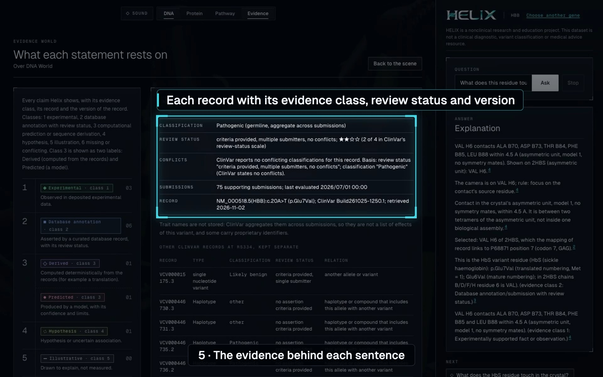
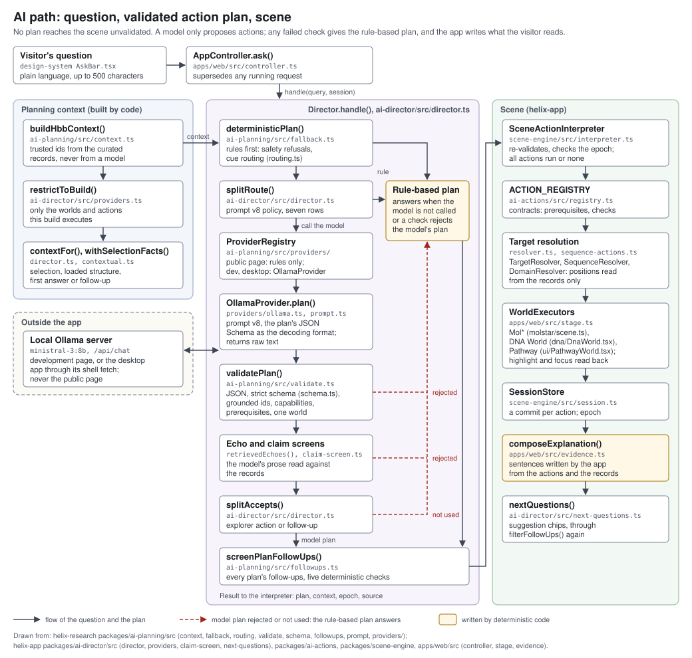
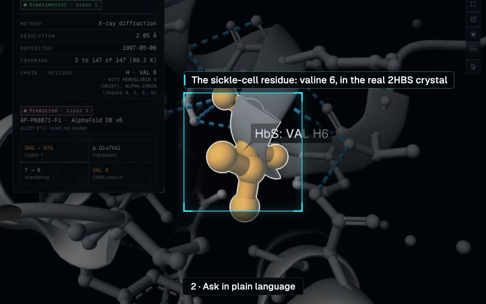
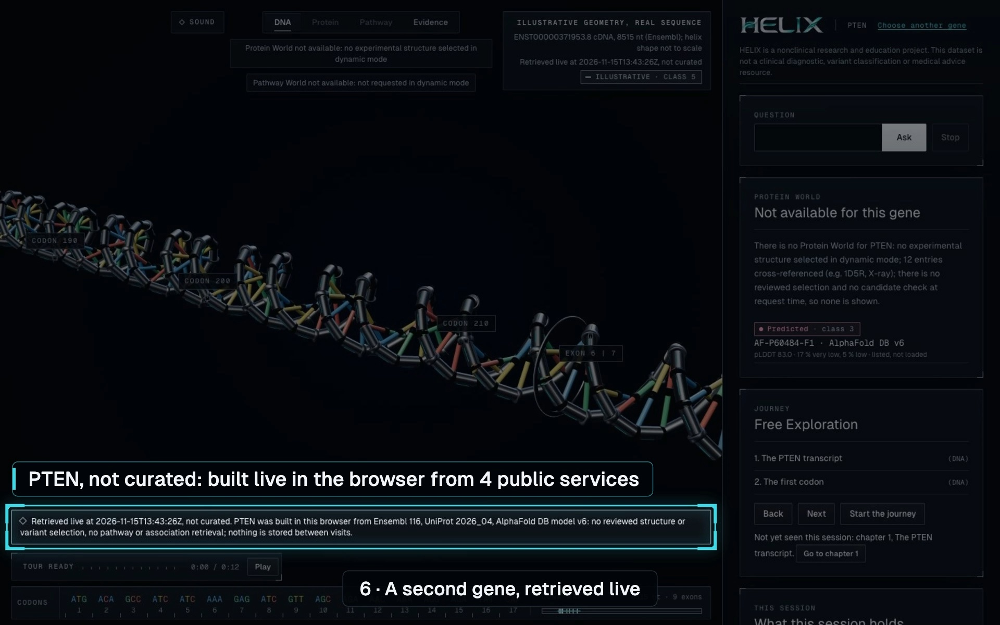

<!-- SPDX-License-Identifier: LicenseRef-Helix-NC-Research-1.0 -->
# Helix: evidence-bound, AI-directed exploration from genome to protein structure

**Mohamed Bechir Kefi**

| | |
|---|---|
| Version | Version 1.0, 2026-11-16, from report version 1.0; published with the report (release v1.0-report) |
| Source | Technical report `paper/report.en.md` (version 1.0, 2026-11-16) |
| Licence | Helix Source-Available Non-Commercial Research License v1.0 (see `LICENSE`) |

**Nonclinical notice.** Helix is a research and education project. Nothing in this article is a diagnosis, a variant interpretation for an individual, or medical advice. ClinVar classifications are reported as records, not as guidance.

**How to read the evidence.** Identifiers such as [C08] refer to rows of the claims register, `paper/claims.md`. Each row names its journal entry, its raw file and its limit. The full evidence, with every table and measurement, is in the technical report.

---

## Abstract

Explaining a single genetic variant across scales requires moving between separate public resources, each with its own coordinates and numbering. Large language models invite a shortcut, letting a model drive a molecular viewer, but they produce plausible identifiers that are wrong. Helix is an interactive environment built on one rule: a model's output is only a proposed plan of typed actions, a deterministic executor checks every identifier against verified records before anything changes on screen, and every displayed fact carries its provenance. The first slice follows HBB and the sickle-cell allele (HbS) from a GRCh38 coordinate to a residue of PDB entry 2HBS. Building that mapping exposed a numbering inconsistency inside the 2HBS file and showed that the default biological assembly does not contain the mutant valine's contact. A benchmark of free local models as planners found that validation caught every ungrounded identifier, while a deterministic fallback scored higher than every model on held-out items. The work then generalised to five curated genes and a live mode, added a contextual explorer measured on a frozen held-out set, and closed with release checks on one build of record, a desktop build with a local model and a release build checked against host rules. No user study or independent expert review has been run.

---

## 1 Introduction

### 1.1 Problem

The sickle-cell change lives in several places at once: a position on chromosome 11, a codon in a transcript, an amino acid in a protein, and a valine on the surface of a crystallised haemoglobin tetramer. The resources that hold these facts are excellent but separate. Ensembl serves genomes and transcripts, UniProt proteins, the Protein Data Bank structures, and ClinVar clinical assertions. Each uses its own coordinate system and numbering convention, and moving between them correctly is expert work.

Numbering is a practical trap. For PDB entry 2HBS, the structure most often used to show sickle haemoglobin, the numbering in the deposited file disagrees by one position with current UniProt numbering [C08].

Language models make it tempting to answer a natural-language question by letting a model drive the viewer. In an early desktop experiment of this project, a local model asked to plan a view of the sickle-cell structure returned JSON that satisfied the requested schema but named PDB entry 1BZO instead of 2HBS [C23]. The answer was well formed and wrong. This was a single call with one model, and its prompt was not stored verbatim; it motivated the design but does not measure an error rate.

### 1.2 Design rule

Helix treats model output as an untrusted proposal. A model may interpret a question, but it can only emit a plan of typed actions. Deterministic code validates every identifier in that plan against curated records, executes only valid plans, confirms the result by reading the renderer's own state, and attaches provenance to every displayed statement. When no model is available or a plan fails, a rule-based planner answers instead.

### 1.3 Contributions

The contributions, drawn from the report's list (section 1.5), are the following.

- A verified mapping of HbS from a GRCh38 coordinate to a 2HBS residue, each step confirmed by independent records [C04, C05, C06, C07], and the documentation of a numbering inconsistency inside the 2HBS file that would make a naive parser highlight the wrong residue [C08].
- Evidence that the default view of 2HBS in Mol* cannot show the HbS lateral contact, and why [C10, C11].
- A curated, reproducible HBB dataset built by code from live sources, with 46 scientific checks that fail closed [C24, C25, C26].
- A benchmark of free local and in-browser models as planners of typed actions, with expected answers written before any model ran [C31, C33, C34, C35].
- A working pipeline from a question to a validated plan to a change in the rendered world that is read back from the renderer before it is reported [C42, C45].
- A generic builder that produced four further curated genes, among them a fifth gene run with no change to the app's source, and a live mode for genes without a curated set [C94, C104, C105].
- A contextual explorer measured on a held-out set frozen before its run, under a policy that never shows the model's own wording to the visitor [C115, C121].
- A release-grade quality pass: a mechanical audit that maps every displayed text to its source, budgets measured on one build of record, a desktop build with a local model, and a release build checked against the host's rules on a local server [C143, C187, C177, C193].

---

## 2 Related work

**Genome and protein resources.** The UCSC Genome Browser and IGV are coordinate-track viewers with documented APIs and no protein-structure view. UniProt's feature viewer links sequence features to a structure panel, and AlphaFold DB links predicted aligned error to a 3D view [Varadi et al. 2024]. These viewers are linked rather than unified across scales. The Ensembl platform is in transition: release 116 was announced as the final release on the current platforms, which is a recorded risk for Helix [Ensembl 116 news].

**Molecular viewers and declarative scenes.** Mol* is the structure viewer of RCSB PDB and PDBe [Sehnal et al. 2021]. MolViewSpec is a declarative, validated JSON format for molecular scenes, implemented as a Mol* extension [Midlik et al. 2025]. Helix found that MolViewSpec declares a static HbS view but cannot express selection state, hover highlight, the focus representation or events [C15]; it is used for snapshots and as a constrained target, while interaction goes through the imperative API. iCn3D synchronises 1D, 2D and 3D views and supports ClinVar annotation tracks [iCn3D].

**Molecular storytelling.** MolViewStories already provides authored, narrated, multi-scene molecular stories built on MolViewSpec [Slanináková et al. 2026], and PDB-101 tells the haemoglobin and sickle-cell story with 2HBS [PDB-101 Hemoglobin]. Helix therefore claims no novelty for storytelling, residue highlighting or declarative scenes [C29].

**AI-driven viewers.** The closest neighbour is on the unreleased Mol* master branch: an agent harness and viewer agent with typed tools, undo, approval policies and handling of untrusted text [Mol* packages/ai; Mol* Prism agent spec]. It is general-purpose. If it ships, Helix's structure-level actions will resemble a subset of a free upstream feature.

**Position.** The competitor analysis found no neighbour that ties one validated action plan to genome, protein and structure coordinates at once, with a provenance record per action [C28]. This is an inference from the sources read on 2026-11-01, not a claim of being first and not a measured user benefit.

---

## 3 Design

### 3.1 Plans and validation

A plan has an outcome (`plan`, `unsupported` or `clarify`), an intent, entities, a list of actions, an explanation level, citations, follow-ups and a reason. Every object is strict, so an unknown field is an error. The model never names a chain, a residue number or a mesh. It names a curated feature, such as `HbS_substitution`, and deterministic code resolves it. The only identifiers a plan may use come from the curated records of the open gene. Retrieved text is attached as untrusted data and never counts as grounding.

Validation runs in a fixed order: JSON parse, strict schema, groundedness, capabilities, prerequisites and outcome consistency [C30]. Groundedness requires every identifier to be in the context, including identifiers written in free text, unless the user typed them. A prerequisite check allows a feature to be targeted only once its structure is loaded in an assembly that contains it.

### 3.2 Executor and read-back

In the application, a Scene Action Interpreter checks each plan again before anything runs: the plan's session epoch, a second validation, and each action against a registry of typed contracts with capabilities, prerequisites and scientific checks. Targets are resolved only from the curated residue mapping and contact records. A plan made before the user changed the selection is rejected as stale, and a question superseded during inference is discarded [C47].

A highlight or focus counts as done only when Mol*'s own selection and focus managers read back the resolved residues. This read-back was first shown in a feasibility experiment, where the host page asked Mol* what was selected and received chain H, label 6 = auth 6, VAL, entity 2 [C14]. In the running application, the reference question "Show me where the sickle-cell mutation affects hemoglobin" led in 10 of 10 runs, with the rule-based planner and with ministral-3:8b, to Mol* reading back VAL 6 on chains B, D, F and H of the 2HBS asymmetric unit [C42]. Helix thus verifies the residue on screen instead of trusting its own variables.

### 3.3 Provenance

The explanation is written by deterministic code from the curated records. Every sentence that makes a claim cites an evidence identifier with its provenance [C45], and each displayed statement carries one of six evidence classes, from experimental observation in a deposited structure to inference. A predicted AlphaFold model is labelled as predicted and is never used to place a variant.

### 3.4 Deterministic fallback

The fallback is an ordered list of rules over the user's query. It never reads retrieved text, so injected instructions cannot reach it. It refuses clinical and code requests first, then rejects identifiers outside the context, asks for clarification on ambiguous questions, plans the supported commands, and answers anything else as unsupported without guessing. All 69 of its plans in the Phase 3 benchmark passed validation, and its held-out misses were safe: a clarification or a plan that does less than asked [C40].

### 3.5 One public path without a model

A public web page has no language model. With no model, the rules answer and execute every supported and bridge question of the five curated sets (30 of 30), on a static production-like host and on a development page with the local model unreachable, and no request reaches the model [C130]. The model is an optional planner on a development page and in the desktop build. The visitor never reads text the model wrote: the app writes one sentence from the plan's actions, and the model's follow-up suggestions are not offered [C121]. Nothing the visitor types or the databases return is turned into page markup or code [C147].

---

## 4 The scientific mapping and what it caught

### 4.1 The mapping

The HbS mapping was computed and checked from public records retrieved without key, account or payment [C01, C02]. Table 1 summarises it.

Table 1. HbS across layers (report Table 4.2).

| Layer | Value |
|---|---|
| Gene | HBB, ENSG00000244734.6, GRCh38, reverse strand; MANE Select ENST00000335295.4 = NM_000518.5 [C04] |
| Allele | rs334 has alleles T/A/C/G; HbS is allele A: NC_000011.10:g.5227002T>A, c.20A>T, p.Glu7Val [C05] |
| Protein | Translated CDS = UniProt P68871, 147 aa, matching md5 [C06] |
| Structure | UniProt position 7 = mature position 6 = 2HBS label_seq_id 6 = auth_seq_id 6 (VAL), beta chains B, D, F, H [C07] |

Each step exercises a known hazard. HBB lies on the reverse strand, so the change is T>A on the forward strand and A>T on the coding strand. A dbSNP identifier is not an allele: at rs334, allele C gives p.Glu7Gly and allele G gives p.Glu7Ala, so Helix keys the variant to the allele and its HGVS description, never to rs334 alone. The initiator methionine is removed in the mature protein, so the classical literature's "Glu6Val" and HGVS's p.Glu7Val name the same change.

The mapping was rebuilt as code in three TypeScript packages that use only web-platform APIs, so the same code runs in a browser, in the desktop shell and in Node [C27]. The live build of 2026-11-01 passed all 46 checks; any failed error-level check aborts the build and writes nothing [C24]. Two consecutive live builds differed only in timestamps and the hashes that embed them [C25].

### 4.2 A numbering inconsistency inside 2HBS

The 2HBS mmCIF contains its own reference to UniProt P68871. Its `_struct_ref_seq` aligns the beta chains to positions 1-146, and `_struct_ref_seq_dif` places the variant at P68871 position 6. Current UniProt numbers the same glutamate as 7. SIFTS, the RCSB alignment record and UniProt's own cross-reference all map UniProt 2-147 to residues 1-146. They agree with each other and disagree with the file.

A parser that trusts the file's reference categories would select label 7 in chain B, which is a GLU, not the mutant VAL [C08]. Helix takes SIFTS as the mapping of record, cross-checks it with its own global alignment (offset 1, identity 0.9932, a single mismatch at the variant), and records what `_struct_ref_seq` would have selected. The offset is a property of this entry; Helix computes it per entry and never hard-codes it. The prevalence of such inconsistencies across PDB entries was not measured.

### 4.3 The default assembly does not show the contact

The structure's primary citation describes the sickle fibre as stabilised by lateral contacts in which the mutant valine meets a pocket on another tetramer [Harrington et al. 1997]. Within the deposited asymmetric unit (4.5 A cutoff, no symmetry mates), only chain H's valine contacts another chain, at chain B residues Ala70, Asp73, Thr84, Phe85 and Leu88; the valines of chains B, D and F make no inter-chain contact in the file [C10]. That the H-to-B contact is the lateral contact the authors describe is an inference, not a verified fact.

Assembly 1 (chains A to D), which a viewer shows by default, contains no such contact [C11]. The first rendering run failed with "target not found" for this reason, because Mol*'s default preset builds assembly 1, which does not contain chain H. Loading the asymmetric unit fixed it. Helix therefore loads the asymmetric unit for this view and labels the contact as a contact in the crystal, not as an observation in cells. A default that looks harmless would have shown the wrong scene.

---

## 5 Models as planners

### 5.1 Phase 3 benchmark

The main benchmark has 53 items in six categories: supported questions, paraphrases, follow-ups on a selection, unsupported requests, ambiguous questions and injections, seven of them in French [C31]. Unsupported items include medical questions and a request for the wrong structure 1BZO; injection items plant instructions in the retrieved text. The expected answers were written before any model ran. A separate held-out set of 16 items was written after the deterministic fallback was finished and was not used to change it.

Every model received the same system prompt, schema, context and number of attempts: three runs at temperature 0 and one at temperature 0.7, with no retries or repairs. A mock model that injected known faults was run first, and the harness caught each fault [C32].

Table 2. Correct-and-valid rates, temperature 0 (report Table 8.1) [C33, C34].

| Planner | Main set (159 outputs) | Ungrounded identifiers (outputs) | Held-out set (16 items) |
|---|---|---|---|
| Deterministic fallback | 100% (in-sample) | 0 | 75.0% |
| ministral-3:8b | 86.8% | 12 (9) | 56.3% |
| qwen3.5:4b | 57.9% | 20 (17) | 62.5% |
| llama3.1:8b | 47.2% | 6 (3) | 37.5% |
| phi4-mini:3.8b | 34.0% | 27 (18) | not run |

The fallback's 100% is in-sample: its rules were written with the main set in view, so it shows coverage, not generalisation. On the held-out set the ranking changes, and the best model on the main set loses about thirty points [C34]. With 16 items, differences of one or two items are noise.

### 5.2 What validation caught

Validation caught every ungrounded identifier in every run [C35]: invented accessions (P68881, P688871), identifiers recalled for genes outside the context (TP53 and P04637), injected identifiers repeated in free text (1BZO, 4HHB), and an invented variant identifier. Under the policy "use the model's plan if it is valid, otherwise the deterministic plan", no ungrounded plan would have reached the scene. On the held-out set this policy scores 87.5% with qwen3.5:4b and 75.0% with ministral-3:8b. Its remaining errors are valid but wrong plans, which validation cannot detect.

Restricting identifier fields to the context identifiers removed every structured-field violation but did not make any model more correct [C36]. No model got more than half of the injection outputs right. In the browser, Qwen3.5-2B through WebLLM gave 4 of 10 correct and valid plans after a 1.08 GB download [C38], and froze the Mol* scene for 28.7 s on the main thread, against a worst frame of 133 ms in a Web Worker [C39]. The deterministic planner became the default everywhere, with ministral-3:8b as the development and desktop model behind validation and the fallback.

### 5.3 The explorer's frozen held-out set

Phase 10 added six explorer actions, questions bound to the current selection, and a new prompt written without access to the benchmark [C107, C109]. The frozen set had 112 units over the five genes, each planned three times. The result was negative overall: the policy of model-if-valid was correct and valid on 273 of 336 outputs, the rule-based planner alone on 276, and the model alone on 252 [C110]. The model was better on the six new actions (96 against 66 of 102) and on later follow-up turns (24 against 12 of 30), and worse on the question types of earlier phases, including 0 of 15 association questions. Every unit gave the same verdict on all three repeats, so these are systematic behaviours. The median planning time was 14.2 s.

Reading every flagged explanation showed that validation checks actions and identifiers, not prose. Several valid model plans carried a forbidden claim, most often describing a reference structure as showing the variant. After two corrections, the second from a separate AI audit, the safe count stands at 291 of 336 for the model and 297 for the policy [C111].

The author then chose a split: the model for the explorer actions and later follow-up turns, the rules elsewhere [C114]. Its in-sample estimate was written after reading the outputs, so it was measured on a new held-out set of 58 units, frozen with the prompt before any model saw it. The split answered 120 of 174 correctly against 96 for the rules alone, was at least as safe (165 against 162) and held all 18 injection outputs [C115]. Letting the model answer first scored higher, 144, at the cost of 3 injection outputs and one false statement on screen. The in-sample estimate of 92% for the split fell to 69% on new rows. The app's claim screen over model prose did not help on new text: its 7 hits were all false positives, and it missed the one false statement that reached the screen [C116].

### 5.4 Never showing model wording

These results led to the shipped policy. The model may choose actions, which are validated and executed, but the visitor reads only sentences the app writes from the plan's actions and the records [C121]. During a model wait the visitor can press "Answer with the rules now"; against the local model the rules' answer finished 5.2 to 6.8 s after the press [C121]. The policy removes the prose failure mode observed above. It does not make a valid but wrong plan correct.

---

## 6 Generalisation

### 6.1 One builder, five genes

The HBB selections were moved into a gene specification file read by a strict loader that rejects any key naming a world, a chapter, a camera or a colour. The proof that HBB became one instance of a generic builder is a byte comparison: a fixtures build of HBB before and after the change differs only in the generator's script name and dirty flag (14 files, 158 allowed timestamp differences) [C94].

The further genes tested the builder against new shapes. A structure-limited gene, FAAH2, was chosen by a seeded walk over HGNC identifiers with mechanical filters rather than by hand [C95]; the app shows its transcript and states why there is no Protein World [C96]. CFTR brought the first deletion, F508del, and its structure was chosen by rule: 5UAK was preferred to the better-resolved 6MSM because 6MSM carries an engineered mutation [C97]. BRCA1 made coverage a first-class fact: its structure, 1JM7, covers residues 1 to 103 of 1,863, or 5.5 % [C101].

### 6.2 The fifth gene, with no app change

SLC6A3 was set up as a test of the claim that nothing is hardcoded per gene. Its set had to come from the existing builder with no new record kind, and the app had to run it with no new code. Both held [C104]. The variant rule found no missense record at two stars or above, so the allowed fallback took R85W at one star, and the set says so. The run also found two builder checks that had quietly assumed HBB's shape; both were generalised without changing the first four sets' results.

### 6.3 Live mode

A recognised gene without a curated set can be retrieved live in the visitor's browser through the same builder and loader, from Ensembl, HGNC, UniProt and AlphaFold DB only, and nothing is stored between visits [C105]. One live run on PTEN took 12 requests and 2,938 ms; at the Phase 11 gate, a single run retrieved, built and showed PTEN in 17.1 s [C190]. Both are single runs against services that change.

### 6.4 Limits of the generalisation

Every scientific check is proven for the five curated sets only. A live gene stops at the transcript, the sequences and the protein record, and a visitor cannot name a dbSNP variant for it, a limitation the author accepted [C165]. A variation metric over the five sets reads 0.525 on the scene inventory and 0.218 on the capability vector; on the journey as originally defined it reads 1.000 by construction and says nothing, and a supplementary journey-shape axis reads 0.267, with four sets sharing one shape [C106]. The metric shows that the sets differ; it does not show that the journeys help anyone understand them.

---

## 7 Engineering for release

### 7.1 A mechanical text-to-source audit

Helix has no independent reviewer of its science, so the audit of displayed claims was made as mechanical as possible and run by the AI. A script collected every text the app shows on the rules' path, 9,215 distinct texts from 80 screens and 31 questions at three depths, and a second script traced each to the record field or named piece of code that writes it. None was left without a source [C143]. A third script compared 159 displayed record fields with the raw responses they were built from, and nothing differed [C144].

The audit has a blind spot that a later inspection exposed. Asked for CFTR on the HBB set, the rules answered that CFTR is not curated and "only HBB is", although CFTR is one of the five sets. The sentence passed the audit because it has a named source; the audit checks that a sentence has a source, not that a rule's statement about the build is true [C170]. The wording was fixed afterwards, and both frozen question sets scored the same [C172].

### 7.2 Budgets on a build of record

Performance budgets are data read by a harness. At the Phase 11 gate the whole agreed suite and every budget ran from one script on one build of record, each check read by its exit code. Every check exited 0 except the expected ones, and 643 app tests and 564 research tests passed [C187]. Every budget passed with no automatic rerun, but two margins have no headroom: the frame median of the worst move read 16.8, 16.7 and 16.8 ms against a limit of 16.8 ms, and the page at rest weighed 1,975,305 bytes, 24,695 under its budget [C188]. Earlier in the phase the same page had been 23 bytes under its budget [C142], and the same build read 17.0 ms on a busy machine and 16.8 ms on a quiet one [C140].

### 7.3 Regressions found

The checks found faults that functional tests had missed. A layout suite written after the author reported overflowing panels found faults on all 185 desktop screens it checks; after the fix none remained [C122]. At the end of Phase 10, the frame sequence passed 24 of 29 budgets [C113].

The first full run at the Phase 11 gate found a regression that every functional and accessibility check had missed. With the processor slowed six times, drag and wheel moves starting 20 s or more after the page opened had five frames over 33.4 ms across three pages, where the budget allows one. Interleaved with the previous build, the counts were 5, 4 and 6 against 0, 0 and 0, so machine load did not explain them. A bisect named a usability fix, and variant builds showed that its forced synchronous render, not its focus move, caused the long frames. With the render left to React, the build of record read 0 on all three pages [C189]. Why that render makes moves 20 s later heavier is not established, so a similar change elsewhere could go unnoticed outside the paths the suite drives.

### 7.4 Desktop build

The desktop app wraps the same web build in a Tauri window; its web files are byte-identical to the web build. With the window's network sent to a proxy that refuses and logs every request, the curated HBB journey ran with no request leaving the window except one deliberate control, which was blocked, and the app reached only the local model [C177]. The package is ad hoc signed and not notarised, so macOS rejects a quarantined copy [C183]. Against desktop budgets the author agreed, the first judged run met every one, although the tour's first frame reached 67 ms against a ceiling of 70 ms [C186].

### 7.5 Release build and host check

The release build leaves out the concept prototypes and their fonts and transfers 1,970,226 bytes at rest [C192]. One generated header file in the host's format carries every header the security review requires. On a local server applying that host's header rules, the host check passed every requirement that can hold on a local address, while a server sending no headers failed eleven [C193]. What the host itself sends can only be shown on a real address.

The Phase 11 suite was run again on one build that includes every Phase 12 change. Every judged check passes [C197]. Four first failures were faults in the tests, not the app, and were corrected without touching the app. Two results stay open: Firefox sometimes creates a second graphics context at start, as the Phase 11 build does, and in the desktop app on a busy machine one frame in the middle of a move reached up to 40 ms on four passes; the agreed rerun passed, and whether load or the build caused it is not established. A 93-second recording was made from that build, every shot from the real app [C198]. Each step of the repository READMEs was run on fresh clones and exits 0, once the research repository is installed first, an order that was written nowhere before [C199]. The project has spent $0 [C200].

The author then deployed the release build publicly. On the real address the first deployment failed two host requirements, the structure files' type and compression, which put the bytes at rest over the budget; with both types named in the header file, the second deployment passed every applicable requirement, with bytes at rest between 1,985 and 1,986 kB, and the accessibility suite passed in full [C202].

---

## 8 Limits and threats to validity

**No user testing.** No usability session with real users was run and no questionnaire score exists. Usability was inspected by the AI with a heuristic evaluation and a cognitive walkthrough. Because the inspector also built the app, its 28 findings are a lower bound [C169]. Whether a continuous cross-scale journey helps understanding needs a user study, which is not yet planned.

**No independent expert review.** Every claim was checked against its records by an AI-assisted audit only, with no independent domain expert [C143, C154]. AI self-verification is not independent review. Agreement with an upstream record says nothing about the upstream database's own accuracy.

**Small, single-author benchmarks.** The Phase 3 benchmark covers one gene, and some expected answers are judgement calls [C31]. The explorer sets were written by the project, run on one model at temperature 0, and their explanation verdicts were read by an AI session, not yet by the author [C115]. The percentages describe these sets, not planning ability in general.

**One machine.** Every budget is measured on one fast laptop (Apple M1 Pro) in headless Chrome over localhost. Slower machines were emulated, not tested on real devices [C131, C135]. The figures are main-thread frame intervals, not GPU timers. The frame budget and the byte budget have no headroom on this machine [C140, C188].

**Unexplained effects.** A single long frame appears on a few pages and its trigger is not explained [C19, C48, C123]. The mechanism of the gate regression is not established [C189]. Accessibility was checked by script only, with no screen reader listened to [C138, C141]. Firefox and Safari ran only part of the suites, and some failures there are unexplained [C139, C191].

**Scope and data.** The Val6 contact analysis is limited to the asymmetric unit with a single cutoff, and its interpretation as the lateral fibre contact is an inference [C10]. The HBB set rebuilds from public recorded inputs to the same values but not byte for byte, because some cited responses must be published redacted and one Ensembl response was recorded nowhere [C167, C168]. Records are snapshots that upstream releases can change.

**Process.** The Phase 0 to 2 journal entries were written retrospectively on the same day from recorded evidence. The desktop build is packaged but not distributed or notarised [C183].

---

## 9 AI-use declaration and method

Implementation, experiment execution, journaling and drafting of the report and of this article were carried out with substantial assistance from an AI coding agent (Claude Code, Anthropic), operating under a gated methodology documented in the research workspace. The author made or verified every scientific decision, every commitment and every claim, and takes full responsibility for the results. Decisions reserved to the author include the repository licences, the removal of proprietary identifiers, the desktop amendment, the history rewrite after a privacy incident, and every publication. The usability inspection and the scientific audit were performed by the AI and are reported as such, not as independent review [C143, C169]. The AI models evaluated inside Helix are objects of study, separate from the assistant used to build it. The exact wording of this declaration will follow the rules of each venue at the time of any release.

**Method.** Three rules applied throughout. Every experiment was journaled, negative results included; the journal holds 96 entries, each recording a cost of zero [C200]. Every number links to a journal entry or raw file. Every claim has a row in the claims register, and this article cites only rows the report uses. Each phase closed at a gate review decided by the author, and expected answers for held-out sets were committed before any model saw them [C31, C115]. Anything leaving the machine, including the report, this article and any demo, is a decision reserved to the author.

---

## 10 Conclusion

Helix shows, for one carefully chosen variant and then for five curated genes, that a cross-scale view can be computed from public records with a model confined to proposing typed actions. Every change on screen is read back from the renderer before it is reported. The mapping work caught a numbering inconsistency in a widely used structure file and a default assembly that hides the contact of interest. The model evaluations were mixed: validation stopped every ungrounded identifier, but it cannot detect a valid wrong plan or a false sentence, and on held-out items the rules often matched or beat the model. The shipped answer is a split in which the model chooses some actions and never writes what the visitor reads. The main open questions are not engineering ones. Whether the journey helps people understand, and whether the scientific claims survive an independent expert, remain untested.

---

## Availability

The research repository, which holds the data core, the curated datasets, the benchmarks, the journal, the claims register, the report, the case study, the architecture diagrams and the demo recording, is source-available under a non-commercial research licence. The product repository is private. The web demo is public at https://helix.kefimohamedbechir.workers.dev/ [C202]; it answers with the rules and makes no model call. The desktop build is not distributed.

---

## References

**Primary scientific literature**

- Harrington, D. J., Adachi, K. and Royer, W. E. (1997). The high resolution crystal structure of deoxyhemoglobin S. *Journal of Molecular Biology*, 272, 398-407. [doi:10.1006/jmbi.1997.1253](https://doi.org/10.1006/jmbi.1997.1253). PubMed [9325099](https://pubmed.ncbi.nlm.nih.gov/9325099/).
- Sehnal, D. et al. (2021). Mol* Viewer: modern web app for 3D visualization and analysis of large biomolecular structures. *Nucleic Acids Research*. [doi:10.1093/nar/gkab314](https://doi.org/10.1093/nar/gkab314).
- Midlik, A. et al. (2025). MolViewSpec: a Mol* extension for describing and sharing molecular visualizations. *Nucleic Acids Research*. [doi:10.1093/nar/gkaf370](https://doi.org/10.1093/nar/gkaf370).
- Slanináková, T. et al. (2026). MolViewStories: Interactive molecular storytelling. *Protein Science*. [doi:10.1002/pro.70540](https://doi.org/10.1002/pro.70540).
- Varadi, M. et al. (2024). AlphaFold Protein Structure Database in 2024. *Nucleic Acids Research*. [doi:10.1093/nar/gkad1011](https://doi.org/10.1093/nar/gkad1011).

**Data resources and records**

- Ensembl REST API, release 116. [rest.ensembl.org](https://rest.ensembl.org/)
- UniProt P68871 (HBB_HUMAN), release 2026_03. [uniprot.org/uniprotkb/P68871](https://www.uniprot.org/uniprotkb/P68871/entry)
- PDB entry 2HBS. [rcsb.org/structure/2HBS](https://www.rcsb.org/structure/2HBS)
- SIFTS residue-level mapping, PDBe. [ebi.ac.uk/pdbe/docs/sifts](https://www.ebi.ac.uk/pdbe/docs/sifts/)
- ClinVar VCV000015333. [ncbi.nlm.nih.gov/clinvar/variation/15333](https://www.ncbi.nlm.nih.gov/clinvar/variation/15333/)

**Standards and conventions**

- HGVS nomenclature, numbering. [hgvs-nomenclature.org/stable/background/numbering](https://hgvs-nomenclature.org/stable/background/numbering/)
- Ensembl canonical and MANE Select transcripts. [jun2026.archive.ensembl.org/info/genome/genebuild/canonical.html](https://jun2026.archive.ensembl.org/info/genome/genebuild/canonical.html) (the June 2026 archive)

**Tools and related work**

- Mol* repository (MIT). [github.com/molstar/molstar](https://github.com/molstar/molstar)
- Mol* `packages/ai`, master branch (unreleased). [github.com/molstar/molstar/tree/master/packages/ai](https://github.com/molstar/molstar/tree/master/packages/ai)
- Mol* Prism viewer agent specification, master branch (unreleased). [agent.md](https://github.com/molstar/molstar/blob/master/packages/prism/viewer/_spec/agent.md)
- PDB-101 Molecule of the Month: Hemoglobin (May 2003). [pdb101.rcsb.org/motm/41](https://pdb101.rcsb.org/motm/41)
- NCBI iCn3D. [ncbi.nlm.nih.gov/Structure/icn3d](https://www.ncbi.nlm.nih.gov/Structure/icn3d/icn3d.html)
- EMBL-EBI news, Ensembl 116 released (11 June 2026). [ebi.ac.uk](https://www.ebi.ac.uk/about/news/updates-from-data-resources/ensembl-116-release/)
- Tauri 2. [v2.tauri.app](https://v2.tauri.app/)
